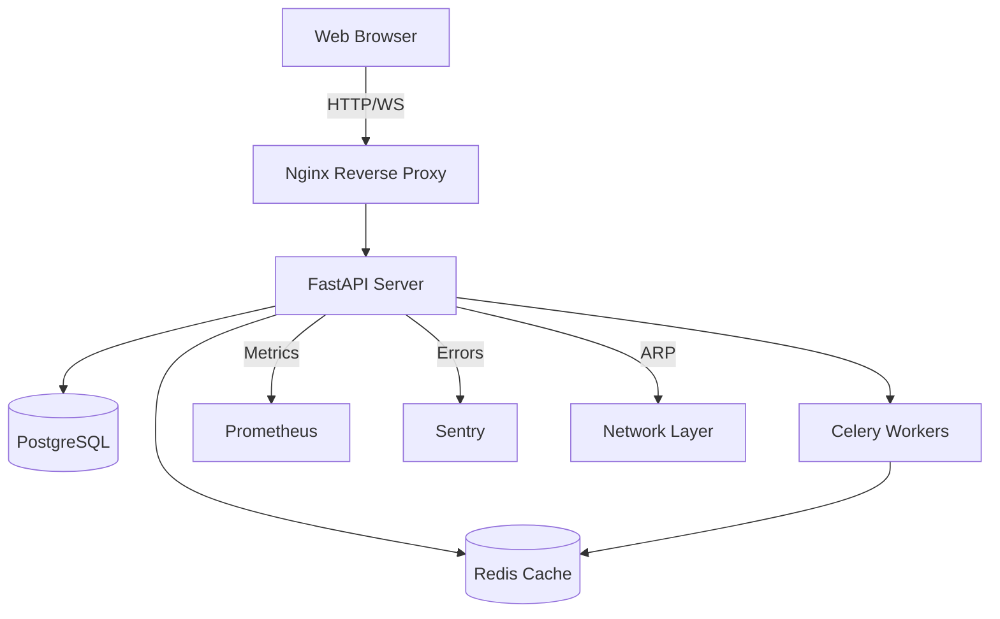
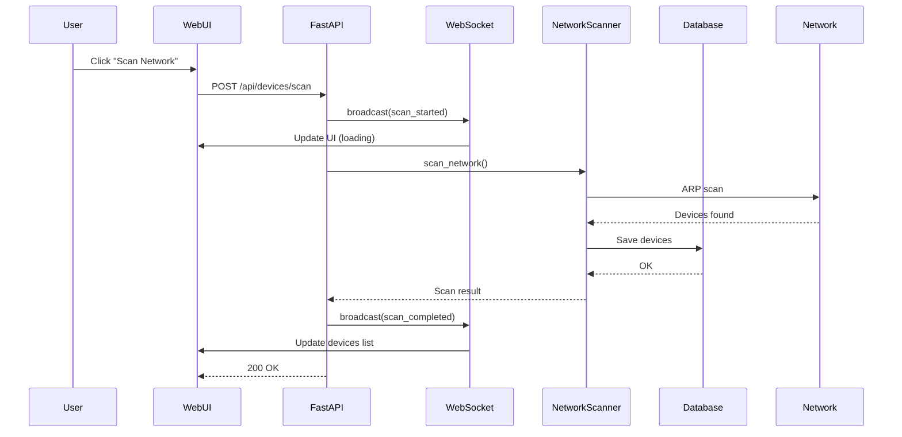
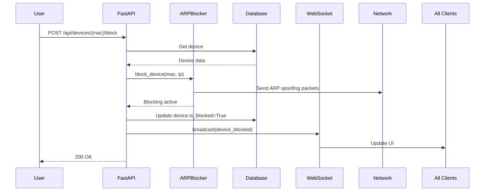

# Architecture

**Autor:** Héctor Alejandro Pérez (@halexespejo-cmd)

---

## 🏗️ System Overview

---

## 📦 Components

### 1. FastAPI Backend

**Responsibilities:**
- REST API endpoints
- WebSocket real-time updates
- JWT authentication
- Request validation (Pydantic)
- Rate limiting (SlowAPI)
- Error handling

**Tech Stack:**
- FastAPI 0.104+
- Uvicorn ASGI server
- SQLAlchemy async
- Pydantic v2

### 2. Database Layer

**PostgreSQL (Production):**
- Connection pooling (10-30)
- Async queries (asyncpg)
- Migrations (Alembic)

**SQLite (Development):**
- File-based `:memory:` for tests
- Zero config

**Models:**
- Device (MAC, IP, vendor, category, status)
- User (username, email, password, role)
- Schedule (blocking schedules)
- ScanHistory (scan metadata)

### 3. Cache Layer (Redis)

**Purpose:**
- GET endpoint caching (30s TTL)
- Session storage
- Rate limit counters
- Celery broker + backend

**Patterns:**
- Cache-aside
- Invalidation on updates
- Key prefix: `devices:*`, `users:*`

### 4. Background Workers (Celery)

**Tasks:**
- `scan_network_task` - Full network scan
- `periodic_network_scan` - Every 5 min (Beat scheduler)
- `check_blocked_devices` - Verify blocking status

**Queues:**
- `network` - Network operations
- `blocking` - ARP operations

### 5. WebSocket Manager

**Features:**
- Connection pooling
- Broadcast to all clients
- User-specific messages
- Auto-reconnection (client)
- Heartbeat (30s)

**Events:**
- `scan_started`, `scan_completed`, `scan_failed`
- `device_discovered`, `device_blocked`, `device_unblocked`
- `heartbeat`

### 6. Observability Stack

**Sentry:**
- Error tracking
- Performance monitoring
- Release tracking

**Prometheus:**
- HTTP request metrics
- Response times
- Active connections
- Custom metrics

**Structured Logging:**
- JSON (production)
- Console (development)
- Context injection (request_id, user_id)

---

## 🔄 Data Flow

### Network Scan Flow

### Device Blocking Flow

---

## 🎯 Design Decisions

### 1. Why FastAPI?

✅ **Async native** - Handle 1000+ concurrent requests  
✅ **Auto OpenAPI** - Interactive API docs  
✅ **Pydantic validation** - Type-safe requests/responses  
✅ **Modern Python** - Type hints, async/await  

### 2. Why WebSocket over Polling?

✅ **Latency** - Instant updates vs 30s delay  
✅ **Bandwidth** - Push only changes vs full snapshots  
✅ **UX** - Real-time feel  
❌ **Tradeoff** - More complex (reconnection, heartbeat)

### 3. Why Redis Cache?

✅ **Performance** - 200ms → 10ms (95% reduction)  
✅ **Load reduction** - Offload DB reads  
✅ **TTL** - Auto-expiration (30s)  
❌ **Tradeoff** - Cache invalidation complexity

### 4. Why Celery?

✅ **Async tasks** - Long-running scans don't block API  
✅ **Scheduled tasks** - Periodic scans (cron-like)  
✅ **Monitoring** - Flower UI  
❌ **Tradeoff** - Extra Redis dependency

### 5. Why SPA (no framework)?

✅ **Simplicity** - No build step, no npm  
✅ **Performance** - 1710 LOC total, fast load  
✅ **Control** - Full control over DOM  
❌ **Tradeoff** - No React ecosystem

---

## 📐 API Design

### REST Principles

- **Resources:** `/api/devices`, `/api/auth`, `/api/tasks`
- **HTTP verbs:** GET (read), POST (create/action), PATCH (update), DELETE
- **Status codes:** 200 (OK), 201 (Created), 400 (Bad Request), 401 (Unauthorized), 404 (Not Found), 500 (Server Error)
- **Pagination:** `?skip=0&limit=100`
- **Filtering:** `?category=IoT&status=active`

### WebSocket Events

**Client → Server:**
- `ping` - Keepalive
- `subscribe` - Subscribe to events

**Server → Client:**
- `scan_started`, `scan_completed`, `scan_failed`
- `device_discovered`, `device_blocked`, `device_unblocked`
- `heartbeat`

---

## 🔒 Security

### Authentication

- **JWT tokens** - Stateless, short-lived (30 min)
- **Bcrypt hashing** - Password storage (cost=12)
- **HTTPBearer** - Authorization header

### Authorization

- **RBAC** - Admin vs User roles
- **Protected routes** - `Depends(get_current_user)`
- **Admin-only endpoints** - `Depends(get_admin_user)`

### Rate Limiting

- **SlowAPI** - 100 req/min global, 50 req/min `/api/status`
- **Per-IP** - Based on client IP

---

## 📈 Scalability

### Horizontal Scaling

- **Stateless API** - No server-side sessions
- **Redis shared cache** - Consistent across instances
- **Load balancer** - Nginx upstream
- **Database pooling** - 10 connections per instance

### Vertical Scaling

- **Async endpoints** - 1000+ concurrent on single core
- **Connection pooling** - Reuse DB connections
- **Cache hit rate** - 80%+ reduces DB load

---

## 🛠️ Technology Choices

| Component | Choice | Alternatives Considered |
|-----------|--------|------------------------|
| Framework | FastAPI | Flask (sync), Django (heavy) |
| Database | PostgreSQL | MySQL, MongoDB |
| Cache | Redis | Memcached, None |
| Queue | Celery | RQ, Dramatiq |
| Frontend | Vanilla JS | React, Vue, Svelte |
| Testing | pytest | unittest, nose |
| Metrics | Prometheus | Datadog, New Relic |

---

For more details, see [API Reference](api.md).
